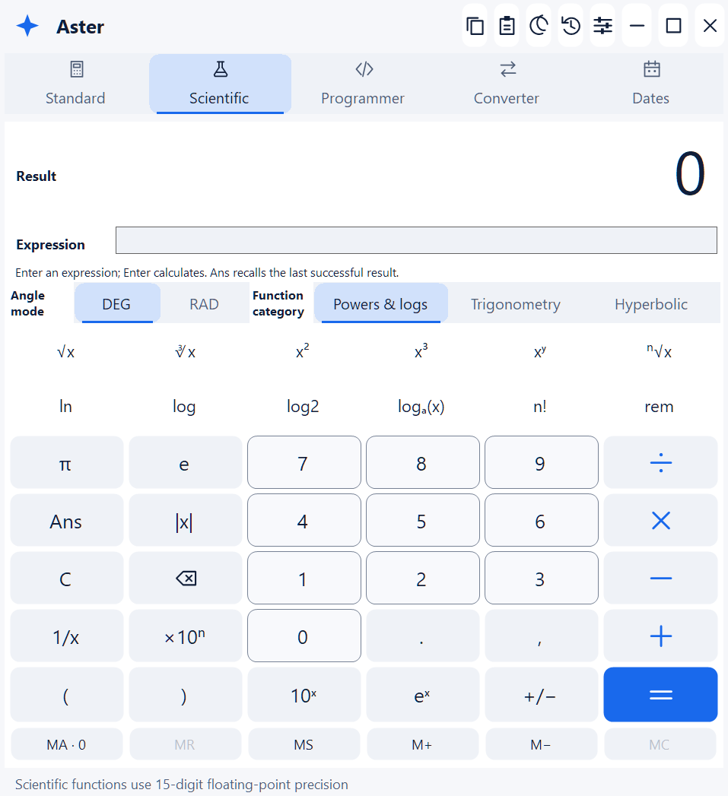
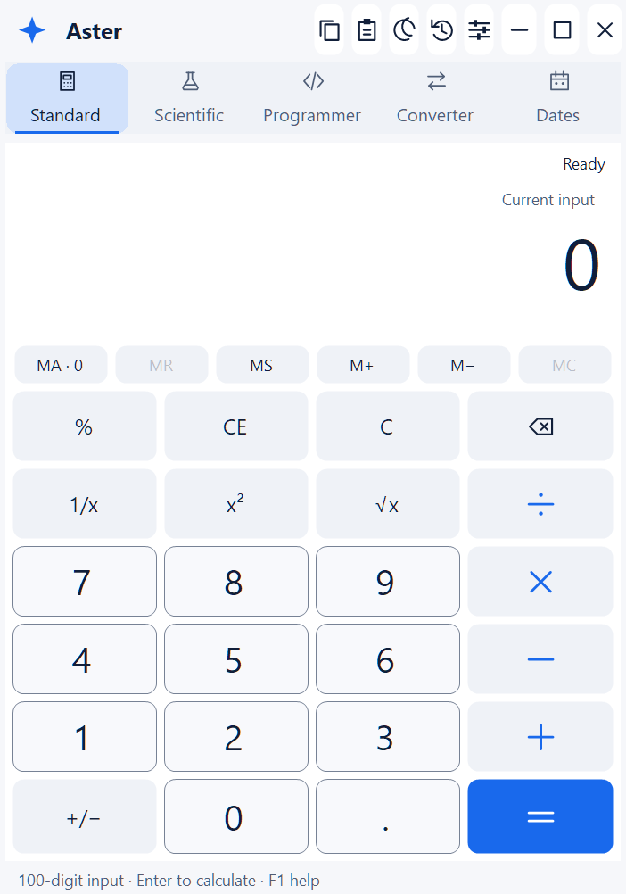
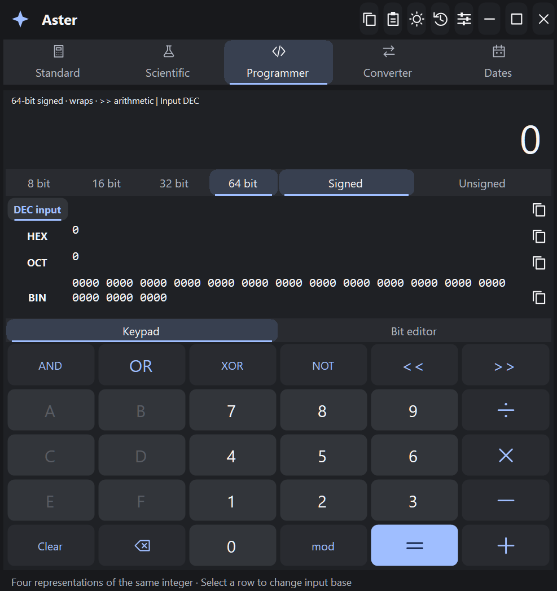
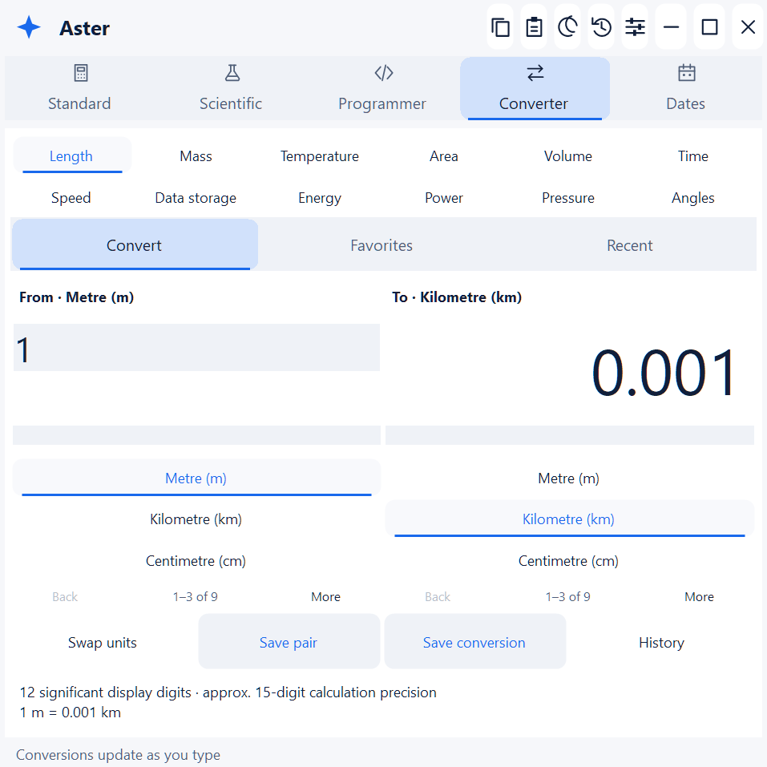
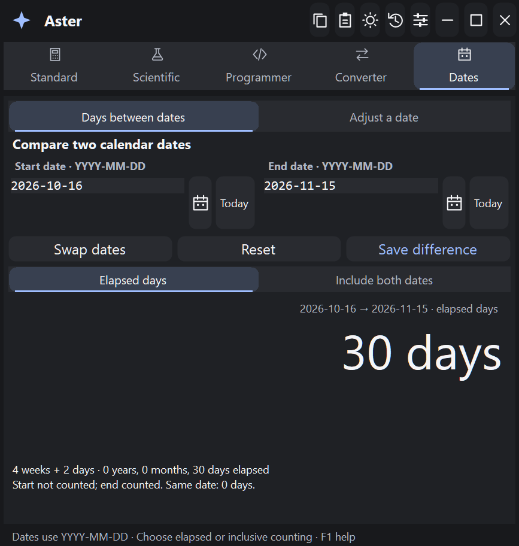
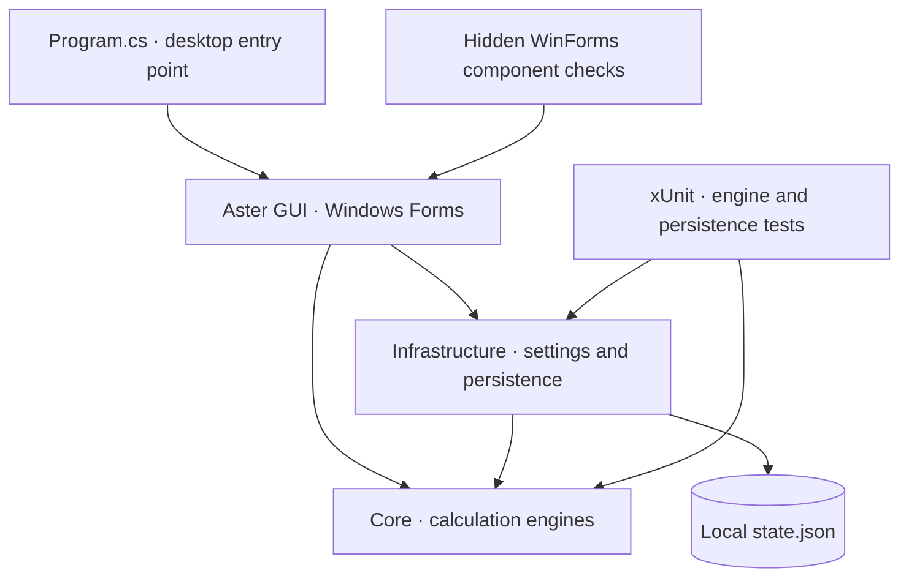

<p align="center">
  
</p>

# 🧮 Aster — Offline Windows Calculator

<p align="center"><strong>A thoughtful space for everyday calculation.</strong></p>

**Aster is an offline Windows calculator for everyday arithmetic, scientific expressions, programmer calculations, unit conversions and date arithmetic.** Its native desktop interface, **Aster GUI**, keeps five calculator modes, searchable history and reusable results in one workspace.

Use it to check a percentage, evaluate a formula, inspect an integer in four bases, repeat a unit conversion or compare dates. Built with **C# 14, .NET 10 and Windows Forms**, Aster runs calculations locally without an account or calculation service.

<p align="center">
  <a href="https://dotnet.microsoft.com/en-us/download/dotnet/10.0"></a>
  <a href="Directory.Build.props"></a>
  <a href="src/ModernCalculator.WinForms/ModernCalculator.WinForms.csproj"></a>
  <a href="LICENSE"></a>
</p>

<p align="center">
  <a href="#readme-quick-start">🚀 Get started</a> ·
  <a href="#readme-gui">🖥️ Explore Aster GUI</a> ·
  <a href="#readme-development">🧪 Build and test</a>
</p>

<details>
<summary><strong>📚 Table of contents</strong></summary>

- [🚀 Quick start](#readme-quick-start)
- [🖥️ Aster GUI — Graphical User Interface](#readme-gui)
- [📸 Aster GUI screenshot gallery](#readme-gallery)
- [✨ Features and real-world use cases](#readme-features)
- [📖 Usage guide](#readme-usage)
- [⌨️ Keyboard shortcuts](#readme-shortcuts)
- [🔬 Numeric behavior and limits](#readme-numeric-behavior)
- [🔐 Configuration, privacy and local data](#readme-configuration)
- [🏗️ Architecture and technology](#readme-architecture)
- [🧪 Testing and development](#readme-development)
- [📦 Build a distributable Windows folder](#readme-publishing)
- [💡 Troubleshooting and FAQ](#readme-troubleshooting)
- [🤝 Contributing](#readme-contributing)
- [📄 License and resources](#readme-license)

</details>

<a id="readme-quick-start"></a>

## 🚀 Quick start

Build from source on **Windows** with the **[.NET 10 SDK](https://dotnet.microsoft.com/en-us/download/dotnet/10.0)** and **Git**. See Microsoft's [supported Windows versions and editions](https://learn.microsoft.com/en-us/dotnet/core/install/windows).

Run these commands in PowerShell; all commands after `cd` run from the repository root:

```powershell
git clone https://github.com/gcfernando/aster.git
cd aster
dotnet restore ModernCalculator.sln
dotnet build ModernCalculator.sln -c Release -m:1
dotnet run --project src/ModernCalculator.WinForms -c Release --no-build
```

**Expected startup:** Aster GUI opens in a centered window. A fresh profile uses the light theme and Standard mode, with history collapsed. Enter `0.1 + 0.2` and press **Enter**: Standard returns exactly `0.3`, using your regional decimal separator.

[global.json](global.json) requests SDK `10.0.100` with `latestFeature` roll-forward, allowing later installed .NET 10 feature bands. Application projects have **no third-party package dependencies**; only the xUnit test project declares NuGet package references. SDK/runtime installation and initial restore can need internet access; calculations work offline.

**Using Visual Studio?** Open [ModernCalculator.sln](ModernCalculator.sln) in **Visual Studio 2026 (18+)** with the **.NET desktop development** workload. Set **ModernCalculator.WinForms** as the startup project and press **F5**. Core and Infrastructure are libraries. See Microsoft's [SDK/Visual Studio compatibility guide](https://learn.microsoft.com/en-us/dotnet/core/porting/versioning-sdk-msbuild-vs); Visual Studio 2022 does not officially support targeting .NET 10.

To run on another Windows computer, [publish a distributable folder](#readme-publishing).

<a id="readme-gui"></a>

## 🖥️ Aster GUI — Graphical User Interface

**Aster GUI is Aster Calculator's existing native Windows Forms desktop interface.** It is implemented in [ModernCalculator.WinForms](src/ModernCalculator.WinForms), uses the Core calculation engines and Infrastructure state store, and publishes as **`Aster.exe`**.

Launch Aster GUI with the Quick start command above, or run `Aster.exe` from a [published folder](#readme-publishing). A framework-dependent folder needs the **.NET 10 Desktop Runtime** on the destination computer; a self-contained folder includes its matching runtime. The optional `ASTER_DATA_DIRECTORY` setting selects a local profile directory; see [configuration and local data](#readme-configuration).

**GUI and command line:** calculations are entered and viewed in Aster GUI. The documented `dotnet` commands build, launch, test or publish the application. The repository does not provide a terminal calculator, browser frontend or HTTP API.

### 🧭 Find your way around Aster GUI

1. **Choose a mode** across the top: Standard, Scientific, Programmer, Converter or Dates. Use on-screen controls, editable fields or the [keyboard shortcuts](#readme-shortcuts).
2. **Keep and reuse results.** Header buttons copy/paste for the active mode. **Ctrl+H** opens searchable history and session memory; **Use result** recalls a card into a compatible mode.
3. **Set your preferences.** Choose light, dark or system appearance, Automatic/Compact density, reduced hover motion, system high-contrast colors or always-on-top. Preferences changes apply with **Save**; Cancel, close or Escape discards the draft.
4. **Arrange the window.** Drag the brand or empty header space, resize at edges/corners and maximize/restore within the monitor's working area. Aster GUI uses visible segments and explicit pages instead of application dropdowns or scrolling panels.

History retains up to **200 calculations**. Search covers the entire journal, and previous/next controls traverse matching entries. Copy, delete or **Use result** acts on the current card. Each completed calculation creates a separate entry, including repeated equals in Standard and reevaluation in Scientific; a single Enter is routed once. History saving between sessions defaults to **off**.

Standard and Scientific share up to **20 decimal memory slots** for the session. Standard places memory above the keypad; Scientific places it below. **MA** opens all slots, **MS** stores a new slot, **MR** recalls the newest, **M+ / M−** updates it and **MC** clears memory. Recalling exact Standard memory into Scientific can round to binary64 without changing the saved value.

Results are selectable and read-only. Long values fit, wrap and use explicit digit pages when needed. **Copy result** preserves the full stored value. Preferences → Numbers selects **3–15 significant display digits** for Scientific and Converter; display rounding does not change the engine's precision. Restore defaults is staged; clearing saved history requires confirmation followed by Save.

<a id="readme-gallery"></a>

### 📸 Aster GUI screenshot gallery

<p align="center">
  <picture>
    <source media="(prefers-color-scheme: dark)" srcset="docs/images/scientific-dark.png">
    <source media="(prefers-color-scheme: light)" srcset="docs/images/scientific-light.png">
    
  </picture>
</p>

<p align="center"><em>Scientific mode: the preview follows your light or dark theme.</em><br><a href="docs/images/scientific-light.png">Light preview</a> · <a href="docs/images/scientific-dark.png">Dark preview</a></p>

| Standard · light | Programmer · dark |
| :---: | :---: |
| [](docs/images/standard-light.png) | [](docs/images/programmer-dark.png) |

| Converter · light | Dates · dark |
| :---: | :---: |
| [](docs/images/converter-light.png) | [](docs/images/dates-dark.png) |

Select a gallery image to view it at full size. These real repository assets are **hidden WinForms component snapshots** of the application's client layout, produced by the UI harness. They are interface previews, not desktop recordings or evidence of physical-input, window-manager or native DPI testing.

<a id="readme-features"></a>

## ✨ Features and real-world use cases

Aster keeps several kinds of calculation in one local workspace. Choose the mode that matches the task and its precision model:

| Your task | Mode | Verified tools |
| --- | --- | --- |
| Check a percentage, subtotal or decimal calculation | **Standard** | Up to **100 significant input digits**; exact bounded addition/subtraction/multiplication; percentages, square/root/reciprocal, repeated equals and calculator undo/redo. |
| Work through numerical formulas or scientific exercises | **Scientific** | Editable expressions, precedence, parentheses, powers, roots, factorials, constants, logarithms, trig/inverse trig, hyperbolic/inverse hyperbolic functions, DEG/RAD and `Ans`. |
| Inspect integer representations or debug bit operations | **Programmer** | Synchronized DEC/HEX/OCT/BIN; 8/16/32/64-bit signed/unsigned arithmetic; wrapping, bitwise operations, shifts, remainder and a paged bit editor. |
| Compare measurements or repeat a unit conversion | **Converter** | Twelve categories; searchable unit names/symbols/English aliases; live results; swap, Favorites and Recent; explicit history saving. |
| Compare dates or adjust a calendar date | **Dates** | Elapsed/inclusive counting, calendar breakdown, ISO input, inline calendars, Today/Swap/Reset, signed intervals and month-end clamping. |

The converter covers **length, mass, temperature, area, volume, time, speed, data storage, energy, power, pressure and angles**. US/Imperial volumes and decimal/binary data prefixes are distinguished.

Choose Aster for local numerical work that benefits from these modes and result reuse. Scientific and Converter use approximate binary64 arithmetic; Standard's higher decimal precision applies to Standard. Currency/live rates, symbolic algebra, complex numbers and time-zone calculations are outside the implemented feature set.

<a id="readme-usage"></a>

## 📖 Usage guide

### 🧮 Standard and Scientific

Standard executes pending operations immediately: `2 + 3 × 4 =` produces **20**. Scientific applies precedence and produces **14**. Standard interprets `200 + 10 % =` as **220**; Scientific and Programmer interpret `%` as **remainder**.

In Scientific, enter an expression and press Enter:

| Expression | Expected behavior |
| --- | --- |
| `sqrt(144) + 2^3` | `20` |
| `sin(30) + logbase(81,3)` | Approximately `4.5` in DEG mode |
| `root(-32,5)` | `-2` |
| `2^3^2` | `512`; powers associate right to left |
| `asinh(2) + acosh(3) + atanh(0.5)` | Evaluates inverse hyperbolic functions |

Use explicit multiplication, such as `2*pi`. Dot-decimal locales separate arguments with commas; comma-decimal locales use semicolons, such as `logbase(81;3)`. Scientific literals accept a dot or the current decimal separator and exclude grouping separators.

Choose **Powers & logs**, **Trigonometry** or **Hyperbolic** to access visible function banks. Expressions remain editable after equals. Editing one or changing DEG/RAD invalidates the old result until you evaluate again; `Ans` retains the last successful answer.

### 💻 Programmer

Select a base row or press **Alt+1–4** to edit Decimal, Hexadecimal, Octal or Binary. In **unsigned 8-bit** mode, decimal `255` is hex `FF`, octal `377` and binary `11111111`. Unsupported keypad digits are disabled, and incomplete input cannot copy a stale result.

**Keypad / Bit editor** changes the workspace. Paged, labeled bit ranges expose every bit without scrolling. Reused history/memory integers preserve their numeric value across display bases where representable.

### 🔄 Unit converter

Choose a category, then search each From/To group by name, symbol or an English alias such as `feet`, `meter` or `°C`. **Back / More**, arrows, Home/End and Page Up/Down reach every match. Enter in a search field chooses the first visible match on the current page.

Results update as you type. **Swap units** reverses the pair. **Save pair** saves a favorite independently of history; **Save conversion**, or Enter in the value field, records a completed conversion. **Recent** restores its value and unit pair. Swap/save actions are disabled while browsing Favorites or Recent. The factor or temperature formula and precision information appear below the controls.

### 📅 Date calculator

**Days between dates** updates live from `YYYY-MM-DD` inputs, Today buttons or inline calendars. Identical dates mean zero elapsed days or one inclusive day; saving is explicit.

**Adjust a date** applies signed years, months, weeks and days using Add or Subtract, while preserving the separate difference inputs. Calendars support keyboard navigation and explicit week paging in compact layouts. Only ISO date results can be reused as dates; day-count history entries remain descriptive.


<a id="readme-shortcuts"></a>

## ⌨️ Keyboard shortcuts

| Shortcut | Action |
| --- | --- |
| `Ctrl+1` … `Ctrl+5` | Switch Standard / Scientific / Programmer / Converter / Dates |
| `Enter` or `=` | Calculate in Standard, Scientific and Programmer |
| `Enter` in Converter / Dates | Save the current conversion / calculate and record the active date workflow |
| `Escape` | Clear a calculator, cancel an inline calendar or close a help/preferences dialog, depending on focus |
| `Delete` / `Backspace` | Clear entry / remove the last character; text fields retain native editing |
| `F9` | Change sign in Standard |
| `Ctrl+C` / `Ctrl+V` | Copy a text selection or full result / paste into the active field or calculator |
| `Ctrl+H` | Show or hide history and memory |
| `Ctrl+Z` / `Ctrl+Y` | Undo/redo Standard actions; editable fields retain native text editing |
| `Alt+1` … `Alt+4` | Choose the Programmer input base |
| `F1` | Open the built-in paged help guide |
| `Tab` / `Shift+Tab` / `Space` | Move focus / activate the focused control |

Preferences → Window also offers **Ctrl+Alt+1–5** for mode switching. Enter activates a focused action reached through keyboard navigation. Aster GUI's header copy/paste buttons operate on the active mode; invalid numeric clipboard input preserves the current value. Paste parsing gives the current culture priority, with invariant dot-decimal notation as a fallback. Programmer paste uses the selected base.

<a id="readme-numeric-behavior"></a>

## 🔬 Numeric behavior and limits

| Engine | Precision and contract |
| --- | --- |
| **Standard** | Bounded base-10 `BigDecimal` backed by `BigInteger`. Up to 100 significant input digits; addition, subtraction and multiplication are exact within bounds. Division and square root round to 100 significant digits, midpoint-to-even. |
| **Scientific** | Binary64 floating point, approximately 15 reliable significant decimal digits. Real-number expressions; no symbolic algebra or complex numbers. |
| **Programmer** | Fixed-width integers modulo `2^width`. Signed decimal uses two's complement; other bases show raw bits. |
| **Converter** | Binary64 factors and offsets, approximately 15 reliable significant decimal digits; temperature inputs are validated against absolute zero. |
| **Dates** | Date-only Gregorian arithmetic from year 0001 to 9999; no time-zone or daylight-saving calculations. |

Display rounding does not change the underlying calculation. Scientific and Converter copy/history use round-trip (`G17`) values. Standard memory and history retain full bounded decimal results, including results longer than the new-input limit.

<details>
<summary><strong>Detailed arithmetic, input and range contracts</strong></summary>

**Standard**

- Leading zeros do not count toward the 100-digit mantissa limit; entered trailing zeros do. Excess precision is rejected. Pasting a copied result follows the new-input limit; recalling a stored result can exceed it.
- Normalized coefficients are limited to **2,000 digits**, scale to **−1,000 through 2,000**, and nonzero adjusted decimal exponents to **−1,000 through +1,000**. `1e-1000` and `9e1000` are supported. Bounds apply to intermediate and final values; violations produce an error. Exact terminating division results need no padding.
- Replacing a pending operator does not execute it. Repeated equals repeats the last operation/right operand. `200 − 10 % =` gives `180`; multiplication gives `20`; division gives `2000`.
- A unary/percentage result is a complete operand; a new digit replaces it. A new digit after equals starts a calculation. Backspace edits only an editable input; CE preserves a pending operation, while C/Escape resets it.

**Scientific**

- Expressions are limited to **2,048 characters** and **64 recursive levels**. The parser does not execute scripts or dynamically evaluate code.
- Factorial accepts integers **0–170**. `0^0` is rejected; `-2^2` is `-4`, and `2^-2` is `0.25`. Tangent is rejected near singularities when `|cos(angle)| < 10^-14`. Hyperbolic functions are dimensionless.
- Binary64 rounding, cancellation and subnormal behavior apply. Invalid domains, nonfinite results, overflow and detected underflow produce readable errors.
- Enter reevaluates the current expression. Keypad operators can continue from the last result; keypad numeric input after equals begins a fresh expression. Memory stores the decimal round-trip representation of the approximate result. Out-of-range or underflowing recall into Scientific is rejected.

**Programmer**

- Parsed out-of-range integers and all results are masked to the chosen width. Division truncates toward zero. Right shift is arithmetic when signed and logical when unsigned.
- Shift counts must be `0..width−1`. Widening sign-extends negative signed values; narrowing masks. Changing width or signedness cancels a pending operation.
- Binary display is grouped in four-bit blocks and padded to the word size. Incomplete input cannot copy a stale result.

**Converter and Dates**

- Valid identity conversions preserve the input after domain validation. Offset-free conversions use a direct scale ratio to avoid unnecessary intermediate overflow/underflow.
- Factors distinguish the international foot/pound, thermochemical calorie, BTU (IT), mechanical/metric horsepower, and US/Imperial volume. A Julian year is exactly 365.25 days. A small negative base-temperature value caused by offset cancellation is clamped to absolute zero within four machine epsilons of the input offset; Kelvin input below zero is rejected.
- Date differences are absolute and elapsed by default; inclusive counting adds one day. Interval adjustment applies years, then months, then weeks/days, clamping at each year/month boundary.

**Result display**

Results are selectable and read-only. Text fits and wraps; previous/next digit pages expose any remaining characters without scrollbars. Selecting text copies that selection; **Copy result** and history-card copy buttons preserve the complete stored value. Long expression captions may be abbreviated.

</details>

<a id="readme-configuration"></a>

## 🔐 Configuration, privacy and local data

Aster GUI uses **Preferences** for everyday settings. No account, API key, database, `.env` file or background service is required.

| Data | Retention |
| --- | --- |
| Preferences and up to 20 favorite unit pairs | Saved to local JSON |
| Calculation history | Up to 200 entries in session; saving between sessions defaults to **off** |
| Memory slots | Up to 20, session only; never persisted |

The default file is `%LOCALAPPDATA%\AsterCalculator\state.json`. The optional **`ASTER_DATA_DIRECTORY`** environment variable overrides its parent directory. For an isolated local profile, set it before launch:

```powershell
$env:ASTER_DATA_DIRECTORY = Join-Path $PWD '.local\readme-profile'
dotnet run --project src/ModernCalculator.WinForms -c Release --no-build
```

The variable applies to processes started from that PowerShell session. Unset it with `Remove-Item Env:ASTER_DATA_DIRECTORY` to return subsequent launches to the default directory.

State uses a temporary file in the same directory followed by replacement. Missing or corrupt data falls back to defaults; save failures remain visible, and session settings continue to work. Disabling history persistence removes saved history on the next successful save while preserving the session list and favorites. Multiple instances use **last writer wins** without merging histories. State is ordinary local JSON and is **not encrypted**.

<a id="readme-architecture"></a>

## 🏗️ Architecture and technology

Aster GUI calls shared engines in-process. Local persistence is handled separately from the calculator views:



| Project or setting | Responsibility |
| --- | --- |
| [ModernCalculator.Core](src/ModernCalculator.Core) | `net10.0` engines, bounded `BigDecimal`/`BigInteger` arithmetic, expression grammar, integer operations, conversions, dates, memory and history; no Windows Forms references. |
| [ModernCalculator.Infrastructure](src/ModernCalculator.Infrastructure) | Validated `AppSettings` and `System.Text.Json` state storage; references Core. |
| [ModernCalculator.WinForms](src/ModernCalculator.WinForms) | `net10.0-windows` GUI executable, forms, mode views, custom controls, vector icons, themes and PerMonitorV2 configuration; references both libraries. |
| [ModernCalculator.Tests](tests/ModernCalculator.Tests) | xUnit, Microsoft.NET.Test.Sdk and the Visual Studio test adapter. |
| [Directory.Build.props](Directory.Build.props) | C# 14, nullable reference types, implicit usings, deterministic builds and warnings treated as errors. |

Mouse and keyboard routes share engine actions. The scientific parser is a bounded recursive-descent parser, not a scripting engine.

### 📁 Repository structure

```text
ModernCalculator.sln
src/
  ModernCalculator.Core/            # Arithmetic, expressions, modes, units, memory, history
  ModernCalculator.Infrastructure/  # StateStore and AppSettings
  ModernCalculator.WinForms/        # Aster GUI: entry point, forms, views, controls, themes
tests/
  ModernCalculator.Tests/           # Engine and persistence regression tests
  ModernCalculator.UiChecks/        # Hidden controls, PNG snapshots and diagnostics
  ModernCalculator.DesktopAudit/    # Optional visible walkthrough with isolated state
tools/                             # Icon generation and specialized audit packaging
docs/images/                       # Existing logo and Aster GUI previews
```

Original vector icons and a bundled multi-resolution executable icon provide the branding. [Generate-Icon.ps1](tools/Generate-Icon.ps1) regenerates the icon on Windows. The README logo is the existing icon's embedded 256-pixel PNG.


<a id="readme-development"></a>

## 🧪 Testing and development

From the repository root, run the engine and persistence suite:

```powershell
dotnet test tests/ModernCalculator.Tests -c Release --logger "console;verbosity=minimal"
```

Coverage includes decimal precision/state, scientific grammar/domains, base/bit operations, conversion round trips, date boundaries, culture-aware input, memory/history, undo/redo and persistence recovery. These tests do not open a window.

Build and run the **Windows-only** hidden component harness:

```powershell
dotnet build tests/ModernCalculator.UiChecks -c Release -m:1
dotnet run --project tests/ModernCalculator.UiChecks -c Release --no-build -- artifacts/UiChecks
```

Every run creates a unique child directory containing `report.json`, `report.txt`, isolated state and PNGs. An optional second argument filters check names. The harness checks native control layout/rendering and handlers across modes, themes, minimum sizes and relative scale simulations.

It does not show windows, inject physical input, exercise the clipboard, change Windows DPI or verify screen-reader output. Desktop focus, window-manager composition and actual monitor/DPI transitions require interactive checks. The [component harness guide](tests/ModernCalculator.UiChecks/README.md) describes the methodology.

For a **visible manual walkthrough** with fresh isolated state:

```powershell
dotnet run --project tests/ModernCalculator.DesktopAudit -c Release
```

DesktopAudit hosts the production MainForm and engines, sends no automated input and stores a fresh session beneath its output folder's `sessions/` directory. It is outside the solution, so this command builds it separately.

<details>
<summary><strong>📋 Existing audit-tooling documentation gaps</strong></summary>

The component guide and specialized packaging script reference `docs/VERIFICATION.md`, `docs/INDEPENDENT_REVIEW.md` and `docs/AUDIT_RESOLUTION.md`, which are absent from this checkout. The packaging script also carries historical report-count defaults. Use the commands here for regular testing/publishing; do not treat those missing files or defaults as a current acceptance record.

</details>


<a id="readme-publishing"></a>

## 📦 Build a distributable Windows folder

Create a **framework-dependent** local build:

```powershell
dotnet publish src/ModernCalculator.WinForms -c Release --self-contained false -o artifacts/publish/framework-dependent
```

Run `artifacts/publish/framework-dependent/Aster.exe` and keep the output folder together. The destination computer needs the **[.NET 10 Desktop Runtime](https://dotnet.microsoft.com/en-us/download/dotnet/10.0)** matching the published architecture.

To bundle the runtime for **Windows x64** instead:

```powershell
dotnet publish src/ModernCalculator.WinForms -c Release -r win-x64 --self-contained true -o artifacts/publish/win-x64
```

This may download the matching runtime pack. Both commands create local publish folders. Share the full output folder appropriate to the destination machine. The specialized [audit packaging script](tools/Package-Audited.ps1) expects prepared acceptance reports and matching published/tested binaries. Its default paths, test counts and audit-document references belong to a separate acceptance workflow; use the direct publish commands for a regular build.

<a id="readme-troubleshooting"></a>

## 💡 Troubleshooting and FAQ

| Symptom | Check or action |
| --- | --- |
| Visual Studio says a class library cannot be started | Select **ModernCalculator.WinForms** as the startup project; Visual Studio can retain an older per-user selection. |
| The .NET 10 target is unavailable | Install the .NET 10 SDK, check `dotnet --list-sdks` and [global.json](global.json), and use Visual Studio 2026 (18+) for IDE builds. |
| A published Aster GUI asks for .NET | Install the matching **.NET 10 Desktop Runtime**, or use a self-contained publish folder. |
| A Scientific function rejects arguments | Match the locale's argument separator, use explicit multiplication and check the function's real-number domain. **F1** opens built-in examples. |
| An edited result cannot be copied | Evaluate again. Scientific expression/angle edits and incomplete Programmer input invalidate the previous copyable result. |
| History is missing after restarting | Saving history defaults to off. Enable Preferences → History and **Save**. Memory is always session-only. |
| Preferences cannot be saved | Check directory permissions or choose a writable `ASTER_DATA_DIRECTORY`; retry Save. Session settings remain active. |
| A long result does not fit at once | Use the digit-page buttons or **Copy result** to obtain the full stored value. |

**Can I use Aster on macOS/Linux or in a terminal?** Aster GUI targets Windows Forms on Windows. The Core/Infrastructure libraries target .NET 10, but the repository supplies no cross-platform GUI or calculator CLI.

**Does “100-digit” apply to every mode?** It describes Standard input and its decimal engine. Scientific and Converter use binary64. See [numeric behavior and limits](#readme-numeric-behavior).

**Do I need to connect online?** Calculation features work offline. Fetching the SDK, test packages or runtime packs can require a connection during setup or publishing.

**Why can the window have square corners?** Windows 11 receives a rounded-corner hint; Windows 10 uses a square fallback. Maximized or snapped windows can retain square corners.

<a id="readme-contributing"></a>

## 🤝 Contributing

Use the [issue tracker](https://github.com/gcfernando/aster/issues) for reproducible problems and proposed improvements. Include the mode, Windows/.NET version, regional settings and exact steps/input. For Aster GUI issues, add the theme, window size and display scaling; use sample data in screenshots.

Keep changes focused, preserve the numeric contracts and run the relevant engine tests and Windows component checks. Update documentation when behavior changes. Start with the [Core engines](src/ModernCalculator.Core) and [Aster GUI mode views](src/ModernCalculator.WinForms/Views) to trace how input reaches a calculation.

<a id="readme-license"></a>

## 📄 License and resources

Aster Calculator is licensed under the **[MIT License](LICENSE)**. Copyright © 2026 Gehan Fernando.

- [GitHub repository](https://github.com/gcfernando/aster)
- [Report a problem or suggest an improvement](https://github.com/gcfernando/aster/issues)
- [Windows component-check guide](tests/ModernCalculator.UiChecks/README.md)
- [.NET 10 SDK and Desktop Runtime](https://dotnet.microsoft.com/en-us/download/dotnet/10.0)

<p align="center"><a href="#readme-quick-start">🚀 Build Aster</a> · <a href="#readme-gui">🖥️ Explore Aster GUI</a> · <a href="#readme-configuration">🔐 Local data and preferences</a></p>

