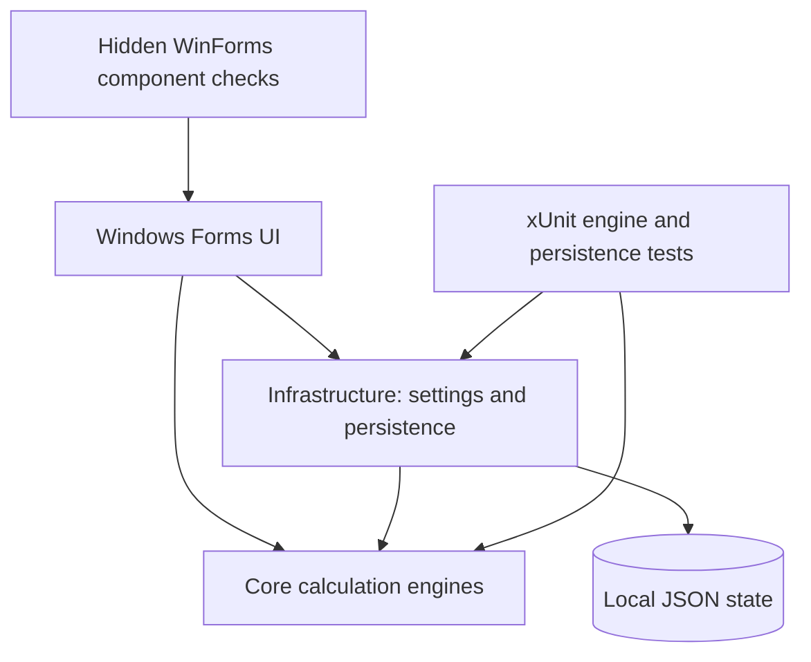

<p align="center">
  
</p>

# Aster · Offline Windows Calculator

<p align="center"><strong>A thoughtful space for everyday calculation.</strong></p>

**Aster is an offline Windows calculator built with C# 14, .NET 10 and Windows Forms.** It brings exact decimal arithmetic, scientific expressions, programmer tools, unit conversions and date calculations into one native desktop app. Use it for everyday percentages, scientific formulas, bit manipulation or calendar arithmetic, with searchable history and reusable results close at hand.

<p align="center">
  <a href="https://dotnet.microsoft.com/en-us/download/dotnet/10.0"></a>
  <a href="Directory.Build.props"></a>
  <a href="src/ModernCalculator.WinForms/ModernCalculator.WinForms.csproj"></a>
  <a href="LICENSE"></a>
</p>

<p align="center">
  <a href="#readme-quick-start">Quick start</a> ·
  <a href="#readme-features">Features</a> ·
  <a href="#readme-usage">Usage</a> ·
  <a href="#readme-numeric-behavior">Numeric behavior</a> ·
  <a href="#readme-development">Development</a> ·
  <a href="#readme-publishing">Publishing</a>
</p>

<p align="center">
  <picture>
    <source media="(prefers-color-scheme: dark)" srcset="docs/images/scientific-dark.png">
    <source media="(prefers-color-scheme: light)" srcset="docs/images/scientific-light.png">
    
  </picture>
</p>

<p align="center"><em>Scientific mode in light and dark themes. Previews are rendered from the application's native controls.</em></p>

<a id="readme-features"></a>

## Five calculator modes ✨

| Mode | What you can do |
| --- | --- |
| **Standard** | Enter up to **100 significant decimal digits**; calculate percentages, squares, roots and reciprocals; repeat equals; undo and redo calculator actions. |
| **Scientific** | Edit expressions with precedence, parentheses, right-associative powers, roots, factorials, logarithms, trig and hyperbolic functions. Switch DEG/RAD and reuse the last answer with `Ans`. |
| **Programmer** | Edit synchronized **DEC / HEX / OCT / BIN** representations; choose 8/16/32/64-bit signed or unsigned arithmetic; apply bitwise operations and shifts; toggle individual bits. |
| **Converter** | Convert across **12 unit categories**, search names/symbols/aliases, swap units, save favorite pairs and restore recent conversions. |
| **Dates** | Compare two dates using elapsed or inclusive counting, inspect a calendar breakdown, or add/subtract signed years, months, weeks and days. |

The unit converter includes **length, mass, temperature, area, volume, time, speed, data storage, energy, power, pressure and angles**. US/Imperial volumes and decimal/binary data prefixes are explicitly distinguished; currency conversion is not included.

Shared across the workspace:

- **History and memory:** search up to 200 calculations, copy or reuse results, and keep up to 20 exact decimal memory slots during a session.
- **Selectable results:** select text directly; explicit digit pages expose long results, while **Copy result** preserves the full stored value.
- **Appearance controls:** light, dark or system theme; Automatic/Compact density; reduced hover motion; system high-contrast colors; always-on-top.
- **Native window behavior:** drag the header, resize edges/corners and maximize/restore within the monitor's working area. Controls use visible segments and pages without application dropdowns or scrolling panels.
- **Offline operation:** calculation features require no account, telemetry service, network connection or live-rate service.

<details>
<summary><strong>View Standard, Programmer, Converter and Dates previews</strong></summary>

| Standard · light | Programmer · dark |
| :---: | :---: |
|  |  |

| Converter · light | Dates · dark |
| :---: | :---: |
|  |  |

These are hidden WinForms **component snapshots**, generated by the repository's UI checks. They show the client layout; they do not capture desktop composition, native monitor transitions or physical input.

</details>

<a id="readme-quick-start"></a>

## Quick start 🚀

### Prerequisites

- **Windows** with .NET 10 support. See Microsoft's [Windows version and edition support matrix](https://learn.microsoft.com/en-us/dotnet/core/install/windows).
- The **[.NET 10 SDK](https://dotnet.microsoft.com/en-us/download/dotnet/10.0)** to build from source. [global.json](global.json) requests `10.0.100` with `latestFeature` roll-forward, allowing later installed .NET 10 feature bands.
- **Git** to use the clone command below.
- Optional: **Visual Studio 2026 (18+)** with the **.NET desktop development** workload. Microsoft documents [.NET SDK and Visual Studio compatibility](https://learn.microsoft.com/en-us/dotnet/core/porting/versioning-sdk-msbuild-vs); Visual Studio 2022 does not officially support targeting .NET 10.

### Build and launch

Run these commands in PowerShell:

```powershell
git clone https://github.com/gcfernando/aster.git
cd aster
dotnet restore ModernCalculator.sln
dotnet build ModernCalculator.sln -c Release -m:1
dotnet run --project src/ModernCalculator.WinForms -c Release --no-build
```

A fresh profile opens a centered, light-theme **Standard** calculator with history collapsed. Enter `0.1 + 0.2` and press **Enter**; Standard returns exactly `0.3` (shown with your regional decimal separator).

For Visual Studio, open [ModernCalculator.sln](ModernCalculator.sln), right-click **ModernCalculator.WinForms** in Solution Explorer, select **Set as Startup Project**, then press **F5**. Core and Infrastructure are class libraries.

Application projects have **no third-party package dependencies**. Only the xUnit test project declares NuGet package references. Initial restore and downloading an SDK/runtime can require internet access; calculations run offline.

<a id="readme-usage"></a>

## Usage 🧮

### Everyday arithmetic and scientific expressions

Standard executes each pending operation immediately: `2 + 3 × 4 =` produces **20**. Scientific applies precedence and produces **14** for the same expression. In Standard, `200 + 10 % =` produces **220**; Scientific and Programmer use `%` for **remainder**.

Select **Scientific**, type an expression and press Enter:

| Expression | Result or behavior |
| --- | --- |
| `sqrt(144) + 2^3` | `20` |
| `sin(30) + logbase(81,3)` | Approximately `4.5` in DEG mode |
| `root(-32,5)` | `-2` |
| `2^3^2` | `512` — powers associate right to left |
| `asinh(2) + acosh(3) + atanh(0.5)` | Evaluates the inverse hyperbolic functions |

Use explicit multiplication, such as `2*pi`. Dot-decimal locales use commas between function arguments; comma-decimal locales use semicolons, such as `logbase(81;3)`. Scientific literals accept a dot or the current decimal separator, and exclude grouping separators. Choose **Powers & logs**, **Trigonometry** or **Hyperbolic** for visible function buttons.

Scientific expressions stay editable after equals. Editing the expression or changing DEG/RAD invalidates the old result until you evaluate again. `Ans` retains the last successful answer.

### Programmer, conversion and date workflows

- **Programmer:** select a base row or press **Alt+1–4** to edit Decimal, Hexadecimal, Octal or Binary. In unsigned 8-bit mode, decimal `255` is hex `FF`, octal `377` and binary `11111111`. Invalid digits are disabled. **Keypad / Bit editor** switches the workspace; paged bit ranges expose every bit.
- **Converter:** select a category and search each unit group by name, symbol or English alias, such as `feet`, `meter` or `°C`. **Back / More** pages through matches; Enter in a search field selects the first visible match. Results update live. **Save pair** saves a favorite; **Save conversion**, or Enter in the value field, records history. **Recent** restores both the value and units. Swap/save actions are disabled while browsing Favorites or Recent.
- **Dates:** use unambiguous `YYYY-MM-DD` inputs, Today buttons or inline calendars. **Days between dates** updates live: identical dates mean zero elapsed days or one inclusive day. **Adjust a date** applies signed intervals without replacing the separate difference inputs. Saving to history is explicit.

### History, memory and preferences

Press **Ctrl+H** to open the secondary panel. Search spans the full history journal; previous/next controls page through matching entries. Copy, delete or **Use result** operates on the current card. Reused Programmer results preserve the integer's value across display bases; Dates can reuse ISO date results, while day-count entries remain descriptive.

Standard places memory above the keypad; Scientific places it below. **MA** shows all slots, **MS** stores a new slot, **MR** recalls the newest, **M+ / M−** updates that slot and **MC** clears session memory. Recalling exact decimal memory into Scientific may round to binary64; the stored memory value remains exact.

The sun/moon button switches light/dark appearance. **Preferences** has Appearance, Numbers, History and Window sections. Set **3–15 significant display digits** for Scientific and Converter, grouping, history persistence and window options. Changes are drafts until **Save**; Cancel, close or Escape discards them. Restore defaults is staged, and clearing saved history requires confirmation followed by Save.

<a id="readme-shortcuts"></a>

## Keyboard shortcuts ⌨️

| Shortcut | Action |
| --- | --- |
| `Ctrl+1` … `Ctrl+5` | Switch Standard / Scientific / Programmer / Converter / Dates |
| `Enter` or `=` | Calculate in Standard, Scientific and Programmer |
| `Enter` in Converter / Dates | Save the current conversion / calculate and record the active date workflow |
| `Escape` | Clear a calculator, cancel an inline calendar or close a help/preferences dialog, depending on focus |
| `Delete` / `Backspace` | Clear entry / remove the last character; text fields retain native editing |
| `F9` | Change sign in Standard |
| `Ctrl+C` / `Ctrl+V` | Copy a text selection or full result / paste into the active field or calculator |
| `Ctrl+H` | Show or hide history and memory |
| `Ctrl+Z` / `Ctrl+Y` | Undo/redo Standard actions; editable fields retain native text editing |
| `Alt+1` … `Alt+4` | Choose the Programmer input base |
| `F1` | Open the built-in paged help guide |
| `Tab` / `Shift+Tab` / `Space` | Move focus / activate the focused control |

Preferences → Window also offers **Ctrl+Alt+1–5** for mode switching. Enter activates a focused action reached through keyboard navigation. Header copy/paste buttons operate on the active mode; invalid numeric clipboard input preserves the current value. Paste parsing gives the current culture priority, with invariant dot-decimal notation as a fallback. Programmer paste uses the selected base.

<a id="readme-numeric-behavior"></a>

## Numeric behavior and limits 🔬

| Engine | Precision and contract |
| --- | --- |
| **Standard** | Bounded base-10 `BigDecimal` backed by `BigInteger`. Up to 100 significant input digits; addition, subtraction and multiplication are exact within bounds. Division and square root round to 100 significant digits, midpoint-to-even. |
| **Scientific** | Binary64 floating point, approximately 15 reliable significant decimal digits. Real-number expressions; no symbolic algebra or complex numbers. |
| **Programmer** | Fixed-width integers modulo `2^width`. Signed decimal uses two's complement; other bases show raw bits. |
| **Converter** | Binary64 factors and offsets, approximately 15 reliable significant decimal digits; temperature inputs are validated against absolute zero. |
| **Dates** | Date-only Gregorian arithmetic from year 0001 to 9999; no time-zone or daylight-saving calculations. |

Display rounding does not change the underlying calculation. Scientific and Converter copy/history use round-trip (`G17`) values. Standard memory and history retain full bounded decimal results, including results longer than the new-input limit.

<details>
<summary><strong>Detailed arithmetic, input and range contracts</strong></summary>

**Standard**

- Leading zeros do not count toward the 100-digit mantissa limit; entered trailing zeros do. Excess precision is rejected. Pasting a copied result follows the new-input limit; recalling a stored result can exceed it.
- Normalized coefficients are limited to **2,000 digits**, scale to **−1,000 through 2,000**, and nonzero adjusted decimal exponents to **−1,000 through +1,000**. `1e-1000` and `9e1000` are supported. Bounds apply to intermediate and final values; violations produce an error. Exact terminating division results need no padding.
- Replacing a pending operator does not execute it. Repeated equals repeats the last operation/right operand. `200 − 10 % =` gives `180`; multiplication gives `20`; division gives `2000`.
- A unary/percentage result is a complete operand; a new digit replaces it. A new digit after equals starts a calculation. Backspace edits only an editable input; CE preserves a pending operation, while C/Escape resets it.

**Scientific**

- Expressions are limited to **2,048 characters** and **64 recursive levels**. The parser does not execute scripts or dynamically evaluate code.
- Factorial accepts integers **0–170**. `0^0` is rejected; `-2^2` is `-4`, and `2^-2` is `0.25`. Tangent is rejected near singularities when `|cos(angle)| < 10^-14`. Hyperbolic functions are dimensionless.
- Binary64 rounding, cancellation and subnormal behavior apply. Invalid domains, nonfinite results, overflow and detected underflow produce readable errors.
- Enter reevaluates the current expression. Keypad operators can continue from the last result; keypad numeric input after equals begins a fresh expression. Memory stores the decimal round-trip representation of the approximate result. Out-of-range or underflowing recall into Scientific is rejected.

**Programmer**

- Parsed out-of-range integers and all results are masked to the chosen width. Division truncates toward zero. Right shift is arithmetic when signed and logical when unsigned.
- Shift counts must be `0..width−1`. Widening sign-extends negative signed values; narrowing masks. Changing width or signedness cancels a pending operation.
- Binary display is grouped in four-bit blocks and padded to the word size. Incomplete input cannot copy a stale result.

**Converter and Dates**

- Valid identity conversions preserve the input after domain validation. Offset-free conversions use a direct scale ratio to avoid unnecessary intermediate overflow/underflow.
- Factors distinguish the international foot/pound, thermochemical calorie, BTU (IT), mechanical/metric horsepower, and US/Imperial volume. A Julian year is exactly 365.25 days. Temperature cancellation within four machine epsilons of the input offset is normalized at absolute zero; Kelvin below zero is rejected.
- Date differences are absolute and elapsed by default; inclusive counting adds one day. Interval adjustment applies years, then months, then weeks/days, clamping at each year/month boundary.

**Result display**

Results are selectable and read-only. Text fits and wraps; previous/next digit pages expose any remaining characters without scrollbars. Selecting text copies that selection; **Copy result** and history-card copy buttons preserve the complete stored value. Long expression captions may be abbreviated.

</details>

<a id="readme-configuration"></a>

## Configuration and local data 🔒

Configure everyday options in **Preferences**. No credentials, API keys, database or service configuration is required.

| Data | Retention |
| --- | --- |
| Preferences and up to 20 favorite unit pairs | Saved to local JSON |
| Calculation history | Up to 200 entries in session; saving between sessions defaults to **off** |
| Memory slots | Up to 20, session only; never persisted |

The default file is `%LOCALAPPDATA%\AsterCalculator\state.json`. The optional **`ASTER_DATA_DIRECTORY`** environment variable overrides its parent directory. For an isolated local profile, set it before launch:

```powershell
$env:ASTER_DATA_DIRECTORY = Join-Path $PWD '.local\readme-profile'
dotnet run --project src/ModernCalculator.WinForms -c Release --no-build
```

The variable applies to processes started from that PowerShell session. Unset it with `Remove-Item Env:ASTER_DATA_DIRECTORY` to return subsequent launches to the default directory.

State uses a temporary file in the same directory followed by replacement. Missing or corrupt data falls back to defaults; save failures remain visible, and session settings continue to work. Disabling history persistence removes saved history on the next successful save while preserving the session list and favorites. Multiple instances use **last writer wins** without merging histories. State is ordinary local JSON and is **not encrypted**.

<a id="readme-architecture"></a>

## Architecture and technology 🏗️



| Layer | Responsibility and technology |
| --- | --- |
| [Core](src/ModernCalculator.Core) | .NET 10 engines, bounded decimal arithmetic, expression grammar, integer operations, conversions, dates, memory and history. No Windows Forms references. |
| [Infrastructure](src/ModernCalculator.Infrastructure) | Validated preferences and `System.Text.Json` persistence; references Core. |
| [WinForms](src/ModernCalculator.WinForms) | `net10.0-windows` executable, custom controls/vector icons, mode views, themes and PerMonitorV2 configuration. Mouse and keyboard routes share engine actions. |
| [Tests](tests/ModernCalculator.Tests) | xUnit, Microsoft.NET.Test.Sdk and the Visual Studio test adapter. |
| [Build settings](Directory.Build.props) | C# 14, nullable reference types, implicit usings, deterministic builds and warnings treated as errors. |

```text
ModernCalculator.sln
src/
  ModernCalculator.Core/            # Calculations, expressions, modes, units, memory, history
  ModernCalculator.Infrastructure/  # StateStore and AppSettings
  ModernCalculator.WinForms/        # Entry point, forms, views, controls, themes, resources
tests/
  ModernCalculator.Tests/           # Engine and persistence regression tests
  ModernCalculator.UiChecks/        # Hidden component checks, PNGs and diagnostics
  ModernCalculator.DesktopAudit/    # Optional manual walkthrough with isolated state
tools/                             # Icon generation and specialized audit packaging
docs/images/                       # README logo and native-control previews
```

The project uses original vector icons and a bundled multi-resolution executable icon. [Generate-Icon.ps1](tools/Generate-Icon.ps1) regenerates the application icon on Windows. The README logo is the existing icon's embedded 256-pixel PNG.

<a id="readme-development"></a>

## Testing and development 🧪

Run the engine and persistence regression suite:

```powershell
dotnet test tests/ModernCalculator.Tests -c Release --logger "console;verbosity=minimal"
```

Tests cover decimal precision/state, scientific grammar/domains, base/bit operations, conversion round trips, date boundaries, culture-aware input, memory/history, undo/redo and persistence recovery. Engine tests do not open a window.

Build and run the Windows-only component harness:

```powershell
dotnet build tests/ModernCalculator.UiChecks -c Release -m:1
dotnet run --project tests/ModernCalculator.UiChecks -c Release --no-build -- artifacts/UiChecks
```

Each run creates a unique child directory containing `report.json`, `report.txt`, isolated state and PNGs. An optional second argument filters check names. The harness constructs hidden native controls and exercises layout/rendering and handlers across modes, themes, minimum sizes and relative scale simulations. It **does not** change Windows DPI, show windows, send physical keyboard/mouse input, exercise the clipboard or verify screen-reader output. See the [component harness guide](tests/ModernCalculator.UiChecks/README.md) for its methodology; its references to separate audit documents are not included in this checkout.

For a visible manual walkthrough using a fresh isolated profile:

```powershell
dotnet run --project tests/ModernCalculator.DesktopAudit -c Release
```

This optional host uses the production MainForm and engines without sending automated input. State is stored in a fresh session beneath its output folder's `sessions/` directory. **DesktopAudit is outside the solution**, so the command builds it separately.

<a id="readme-publishing"></a>

## Publish a Windows build 📦

Create a **framework-dependent** local build:

```powershell
dotnet publish src/ModernCalculator.WinForms -c Release --self-contained false -o artifacts/publish/framework-dependent
```

Run `artifacts/publish/framework-dependent/Aster.exe` and keep the output folder together. The destination computer needs the **[.NET 10 Desktop Runtime](https://dotnet.microsoft.com/en-us/download/dotnet/10.0)** matching the published architecture.

To bundle the runtime for **Windows x64** instead:

```powershell
dotnet publish src/ModernCalculator.WinForms -c Release -r win-x64 --self-contained true -o artifacts/publish/win-x64
```

This may download the matching runtime pack. Both commands create local publish folders; choose the distribution appropriate to your destination machine. The specialized [audit packaging script](tools/Package-Audited.ps1) expects prepared acceptance reports and matching published/tested binaries. Its default paths, test counts and audit-document references belong to a separate acceptance workflow; use the direct publish commands for a regular build.

<a id="readme-troubleshooting"></a>

## Troubleshooting 💡

| Symptom | What to check |
| --- | --- |
| Visual Studio says a class library cannot be started | Set **ModernCalculator.WinForms** as the startup project. Visual Studio can retain an older per-user selection. |
| The .NET 10 target is unavailable | Install the .NET 10 SDK; check `dotnet --list-sdks` and [global.json](global.json). Use Visual Studio 2026 (18+) for IDE builds. |
| A published app asks for .NET | Install the matching **Desktop Runtime**, or publish a self-contained build. |
| A scientific function rejects its arguments | Match the locale's argument separator, use explicit multiplication and check the function's real-number domain. Press **F1** for built-in examples. |
| A result cannot be copied after an edit | Evaluate again. Scientific expression/angle edits and incomplete Programmer input invalidate the previous copyable result. |
| History is missing after restart | Persistence defaults to off. Enable it under Preferences → History and **Save**. |
| Preferences cannot be saved | Check directory permissions or choose a writable `ASTER_DATA_DIRECTORY`; retry Save. Changes remain active for the session. |

Windows 11 receives a rounded-corner hint; Windows 10 uses a square fallback. Maximized or snapped windows may retain square corners. Desktop focus, monitor transitions, physical input, clipboard behavior and screen-reader output need interactive verification beyond the hidden component checks.

<a id="readme-contributing"></a>

## Contributing 🤝

Use the [issue tracker](https://github.com/gcfernando/aster/issues) for reproducible problems or proposed improvements. Include the affected mode, Windows/.NET version, regional settings and exact input or steps. For UI issues, include theme, window size and display scaling; use sample data in screenshots.

Keep changes focused, preserve the numeric contracts above, and run the relevant engine tests and Windows component checks. Update documentation when behavior changes. The [Core engines](src/ModernCalculator.Core) and [mode views](src/ModernCalculator.WinForms/Views) are useful starting points for understanding how input reaches a calculation.

<a id="readme-license"></a>

## License 📄

Aster Calculator is licensed under the **[MIT License](LICENSE)**. Copyright © 2026 Gehan Fernando.

<p align="center"><a href="#readme-quick-start">Build Aster</a> · <a href="#readme-configuration">Local data and preferences</a> · <a href="https://github.com/gcfernando/aster">GitHub repository</a></p>

